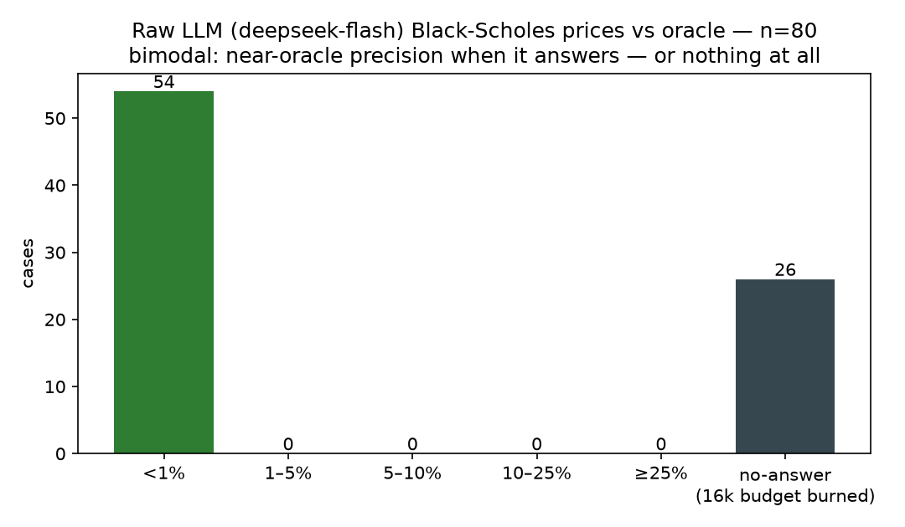
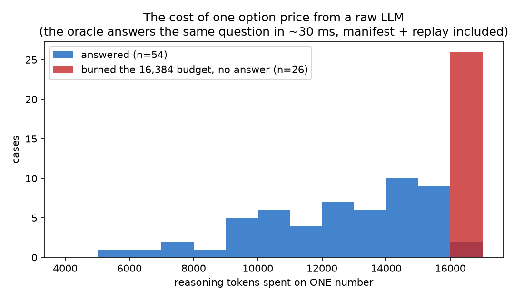

# One number, two ways: a raw LLM vs an oracle on option prices

> 中文导读见文末。

Agent trading frameworks — TradingAgents-style debate stacks, hedge-fund agent
crews, the whole family — let numeric claims travel through the conversation as
text. Almost none of them pin those numbers to anything. So we ran the simplest
checkable experiment we could: **ask a raw LLM for an option price, with no
tools and no code, and grade it against an oracle.**

The result is not the story you'd guess. The model is not bad at math. It is
*unreliable at being good* — and that distinction is the whole argument for a
tool layer.

## Setup

- **Questions (n=80, seed-pinned, reproducible)**: European call/put
  Black-Scholes prices; spot 100; moneyness K/S ∈ [0.85, 1.15]; 14–365
  calendar days; volatility 10–50%; risk-free 0–6% continuously compounded;
  no dividends. Sampled deterministically (seed 202601106 → see
  `run_experiment.py`, `raw.json` for every case and answer).
- **The LLM**: `deepseek-flash` via the raw chat API, temperature 0,
  max_tokens 16,384, zero-shot, one prompt shape: "answer with ONLY the
  number".
- **The oracle**: `trustquant price_european_option` (`bs_analytic.v1`),
  whose engine is pinned against QuantLib 1.33 golden fixtures. Every oracle
  answer carries a `calculation_id` + manifest and replays bit-identically
  (all 80 recorded in `raw.json`). Wall-clock: ~30 ms per case.

## Result 1 — when it answers, it is near-oracle accurate

54 of 80 questions got a numeric answer. Their accuracy:

| stat (n=54) | \|relative error\| vs oracle |
|---|---|
| median | **0.09%** |
| mean | 0.10% |
| p90 | 0.23% |
| max | 0.44% |

Every single answered case landed inside 1%. There is no error tail — and no
regime pattern either (OTM/ATM/ITM medians 0.09%/0.12%/0.07%). The model
effectively *hand-executes the Black-Scholes algorithm in its head*, step by
step, at ~9 basis points of accuracy.

## Result 2 — 32.5% of the time it never answers at all

The other 26 questions returned an **empty answer**: the model spent its
entire 16,384-token budget inside its own reasoning — literally Taylor-expanding
the normal CDF by hand ("Need precise. φ0 at 0.82…") — and hit the length cap
before emitting a final number. Every one of the 26 no-answers is a budget
burnout, not a refusal.

And it is not explainable by difficulty: burnout cases' days-to-expiry and
volatility ranges fully overlap the answered cases'. It is a reliability
lottery with roughly one-in-three odds, per number, on a canonical,
training-data-saturated formula.



## Result 3 — the cost of one number

Median reasoning spend per question: **14,585 tokens** (answered cases alone:
13,110 median, 5,899–16,270 range; burnouts pinned at the cap). For
comparison, the oracle prices the same question in ~30 ms with a manifest and
replay receipt.



## What this means for agent-framework design

1. **The dangerous failure is not the empty answer — it's what the pipeline
   does with it.** A 32.5% silent-empty channel inside a multi-agent debate
   means downstream agents either stall, or an orchestrator "helpfully"
   interpolates a number that then carries full narrative confidence.
2. **Accuracy without provenance is still unauditable.** Even the 0.09%-accurate
   answers arrive with no units, no conventions, no version pin, no replay.
   Unit conventions are exactly where unaided LLM numbers historically die
   (Vega per 1.00 vol vs per 1%: see `crosscheck/vibe_units.md` for how even
   *tool layers* disagree there).
3. **The right split is: the LLM decides *what* to compute; an oracle computes
   it.** That is the division TrustQuant exists for — and the discipline its
   DSH skill hard-codes ("compute, don't recall"). Black-Scholes is the
   *friendly* case here: closed-form, canonical, checkable. The less canonical
   the computation (day-counts, curve bootstrap, portfolio risk), the wider the
   gap between a recalled number and a computed one.

## Limits of this experiment (read before citing)

- One model (`deepseek-flash` — chosen because it is what our own agent stack
  runs), one prompt shape, zero-shot, temperature 0 (not perfectly
  deterministic server-side; the committed `raw.json` is the dataset of record).
- Black-Scholes is maximally LLM-friendly: closed-form and saturates training
  data. Do not extrapolate the 0.09% to "LLMs are accurate at quant" — the
  burnout rate and the missing provenance are the transferable findings.
- Parameters were kept in benign ranges; extreme wings and near-zero premiums
  are untested here.
- No Greeks, no convention-loaded asks — those are covered by the crosscheck
  approach instead (`crosscheck/`).

## Reproduce

```bash
# analyze the committed dataset (no API needed): stats + charts
python3 essays/llm-numbers-vs-oracle/run_experiment.py

# refresh raw.json (needs DEEPSEEK_API_KEY; ~20 min, 80 API calls)
python3 essays/llm-numbers-vs-oracle/run_experiment.py --run
```

Artifacts: `raw.json` (every case, both answers, oracle calculation_ids),
`stats.json`, `error_buckets.png`, `reasoning_cost.png`.

---

## 中文导读

给裸 LLM（无工具、无代码）80 道期权定价题，用 TrustQuant（QuantLib 1.33 金样例钉死的
oracle）判卷：**答出来的 54 题全部误差 <1%（中位 0.09%）——模型等于在脑内手推 Black-
Scholes 到 9 个 bp；但另外 26 题（32.5%）把 16384 token 预算全烧在手算正态 CDF 泰勒
展开上，一个字都没答**；每题中位推理消耗 14,585 token，而 oracle 约 30ms 出数并附
manifest + 重放凭证。结论不是"LLM 不会算数"，而是"**精度尚可、可靠性不可用**"：
三成概率空手、数字无单位无口径无凭据——放进 TradingAgents 式多智能体交易循环，空答
比错答更危险。正确分工：LLM 决定算什么，oracle 负责算。原始数据、脚本、图表全部入库
可复现。
